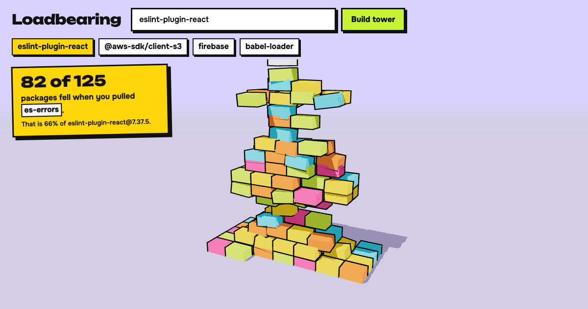

# Loadbearing

Type any npm package. Its dependencies become a 3D tower. Pull one tiny block and watch
everything that depends on it fall.



One tiny package, `es-errors`, sits under **82 of the 125** packages that make up
`eslint-plugin-react@7.37.5`. Pull it and 66% of the tower comes down.

## Run it

```sh
pnpm install
pnpm dev          # http://127.0.0.1:5173
```

Needs Node 22+ and pnpm. Try `?pkg=eslint-plugin-react&pull=es-errors` for a ready-made collapse.

## How to read the tower

- Every block is one package version. The package you searched is the white block on top.
- A block rests on what it depends on, so the leaves (packages with no dependencies) are at the bottom.
- Click a block, use the list on the right, or press "Pull the riskiest block".
- **Record 10 s clip** pulls the riskiest block for you and saves an MP4 (H.264, up to 1920 px wide)
  with the result drawn on it, ready to post.

## What "fell" really means

The count is the number of **transitive dependents** of the pulled package in the dependency graph
that [deps.dev](https://deps.dev) resolved for that exact version: everything that requires it,
directly or through other packages. It is a graph fact, not a guarantee that each of those packages
would crash at runtime (an optional or lazily loaded dependency may never be hit). The physics is a
visual: the right blocks fall because the graph says so, not because the stack is balanced.

Other honest limits:

- Graphs are shown with up to 300 blocks. If a package has more, the blocks with the biggest blast
  radius are kept, the rest are dropped, and the footer says how many are hidden. The count in the
  headline always uses the full graph, but the dropped middle blocks mean some chains between
  visible blocks are missing in the picture.
- Very new releases are often not resolved by deps.dev yet. Loadbearing then uses the newest stable
  release that is, and the footer says so.
- A package with no dependencies has nothing to stack.

## Privacy

No analytics, no cookies, no account, no tracking. The page only calls the public
[deps.dev API](https://docs.deps.dev/api/) (package names you type go there) and loads its fonts
and code from its own origin. Recording happens entirely in your browser; the clip never leaves it
unless you post it. A Playwright test fails if the app contacts any other host.

## Tech

Vite, React 19, TypeScript (strict), react-three-fiber and three.js, Rapier (physics, WebAssembly),
zod (every API response is validated before use), Vitest, Playwright, oxlint and oxfmt.

```
src/domain   graph maths and tower layout, pure functions, no React
src/data     deps.dev client (validation, version fallback), bundled preset graphs
src/scene    3D scene, instanced blocks, falling-block physics
src/lib      MP4 recorder, small stores
```

```sh
pnpm check       # types, lint, format, 31 unit tests
pnpm test:e2e    # 7 browser tests against a production build, network mocked
```

Known cost: the 3D scene (three.js plus the physics WebAssembly) is a separate ~1.9 MB gzipped chunk
that loads right after the search bar paints. The first screen itself is about 100 KB gzipped.

## Presets

`node scripts/make-presets.mjs` re-fetches the bundled example graphs from deps.dev. They were
picked by scanning about 55 popular packages for the biggest share taken down by a single tiny block.

## Credits and prior art

- [three.js](https://threejs.org/) (@threejs), [react-three-fiber](https://github.com/pmndrs/react-three-fiber) (Poimandres, @pmndrs) and [Rapier](https://rapier.rs/) (Dimforge, @dimforge) do the 3D and the physics.
- Dependency data: [deps.dev](https://deps.dev) (Google Open Source Insights).
- Fonts: [Unbounded](https://github.com/googlefonts/unbounded) and [Onest](https://fonts.google.com/specimen/Onest), both under the SIL Open Font License.
- The idea of a package as a tower of blocks is [xkcd 2347](https://xkcd.com/2347/). [Stacktower](https://github.com/matzehuels/stacktower) built dependency towers before this did, and a few other 3D dependency tools exist. What this adds: any npm package by name, a real blast-radius count, pulling a block, and a one-click clip.
- The look is hand-written CSS in a neobrutalist style. No UI library is used.

## Licence

MIT. Dependency data comes from deps.dev (Google Open Source Insights) and is subject to its terms.
